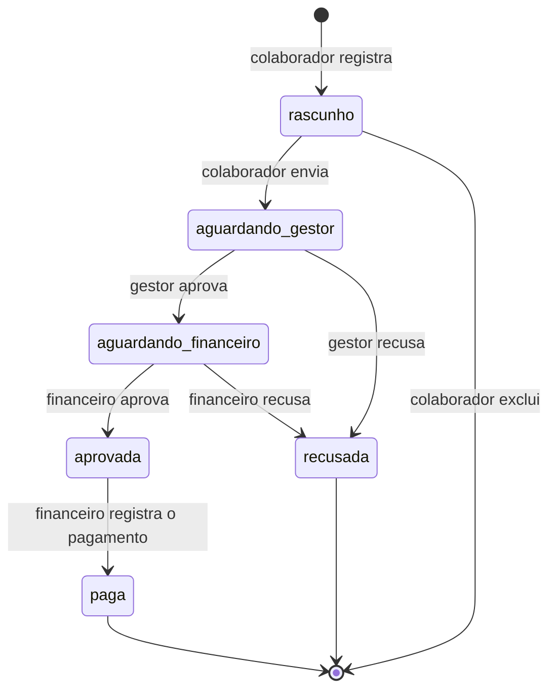
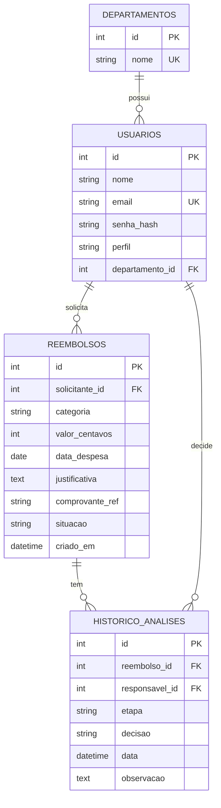

# Documentação técnica: Plataforma de Gestão de Reembolsos (NexusCorp)

## 1. Descrição da solução

A solução é uma API REST em Python (FastAPI) que substitui as planilhas e os e-mails usados hoje para pedir e aprovar reembolsos. Ela resolve os problemas apontados pela NexusCorp:

| Problema da empresa | Como a solução responde |
|---|---|
| Colaboradores veem dados financeiros de outros | Cada solicitação só é visível ao dono e, dentro de limites, a quem precisa analisá-la (RN02) |
| Aprovações por quem não é responsável | O gestor só analisa o próprio departamento (RN03); o financeiro só analisa o que o gestor aprovou (RN08) |
| Despesas duplicadas | A referência do comprovante não pode se repetir para o mesmo colaborador (RN05) |
| Sem controle de quem aprovou | Cada decisão é gravada com responsável, etapa, resultado, data e observação (RN12) |
| Solicitações alteradas após a aprovação | Só o rascunho pode ser alterado ou excluído (RN07) |
| Informações sensíveis sem restrição | Login obrigatório, senhas criptografadas e respostas sem dados de credenciais (RN01, RN13) |
| Sem histórico completo das decisões | Cada solicitação traz o histórico de análises na consulta de detalhe |

**Organização do código**

- `models.py`: tabelas e relacionamentos do banco.
- `schemas.py`: contratos de entrada e saída, com as validações dos dados.
- `security.py` e `deps.py`: senhas, token e verificação do perfil de quem chama.
- `routers/`: as rotas, separadas por assunto (login, usuários, reembolsos, análises).

**Fluxo de aprovação**



Qualquer transição fora deste diagrama é recusada com o código 409. Solicitações `paga` ou `recusada` não podem mais ser modificadas nem excluídas.

## 2. Modelo de dados



**Relacionamentos**

- Um departamento possui vários usuários, e cada usuário pertence a um único departamento.
- Um usuário pode registrar várias solicitações, e cada solicitação pertence a um solicitante.
- Uma solicitação pode ter vários registros de análise, e cada registro identifica o usuário que decidiu.
- O banco confere as chaves estrangeiras (`PRAGMA foreign_keys=ON`), então não existe solicitação sem solicitante nem análise sem solicitação.

**Restrições dentro do banco**

| Restrição | Efeito |
|---|---|
| `usuarios.email` único | Não há dois usuários com o mesmo e-mail |
| `departamentos.nome` único | Não há departamentos repetidos |
| `reembolsos`: único (`solicitante_id`, `comprovante_ref`) | Impede comprovante repetido para o mesmo colaborador (RN05) |
| `reembolsos`: `valor_centavos > 0` | Impede valor zero ou negativo (RN04) |

**Valores permitidos**

| Campo | Valores |
|---|---|
| `perfil` | `colaborador`, `gestor`, `financeiro` |
| `categoria` | `alimentacao`, `transporte`, `hospedagem`, `material` |
| `situacao` | `rascunho`, `aguardando_gestor`, `aguardando_financeiro`, `aprovada`, `paga`, `recusada` |
| `etapa` (histórico) | `gestor`, `financeiro`, `pagamento` |
| `decisao` (histórico) | `aprovada`, `recusada`, `paga` |

O dinheiro é guardado em **centavos inteiros** (R$ 180,00 vira `18000`), para evitar erros de arredondamento. Na API o valor entra e sai em reais (`180.00`).

## 3. Contrato das principais operações

**Convenções**

- Formato: JSON. Rotas protegidas exigem o cabeçalho `Authorization: Bearer <token>`.
- O login recebe um formulário (`username` com o e-mail e `password`), padrão OAuth2.
- Erros comuns têm o formato `{"detail": "mensagem"}`. Erros de validação (422) trazem a lista dos campos inválidos em `detail`.

**Códigos de resposta**

| Código | Significado | Exemplo |
|---|---|---|
| 200 / 201 / 204 | Sucesso (consulta e alteração / criação / exclusão sem conteúdo) | |
| 401 | Falha de identificação | Sem token, token inválido ou expirado, senha incorreta |
| 403 | Falta de permissão | Colaborador tentando ver solicitação alheia; gestor de outro departamento |
| 404 | Recurso inexistente | Solicitação com id que não existe |
| 409 | Violação de regra de negócio | Comprovante repetido; alterar solicitação já enviada; pular etapa do fluxo |
| 422 | Dados inválidos | Valor ≤ 0, data futura, campo faltando, campo proibido, recusa sem justificativa |

**Todas as operações**

| Método e rota | O que faz | Respostas |
|---|---|---|
| `POST /auth/login` | Entra no sistema e recebe o token | 200, 401, 422 |
| `GET /auth/me` | Dados do usuário logado | 200, 401 |
| `GET /departamentos` | Lista os departamentos | 200 |
| `POST /usuarios` | Cadastra usuário (sempre como colaborador) | 201, 409, 422 |
| `PATCH /usuarios/me` | Altera o próprio nome ou a própria senha | 200, 401, 403, 422 |
| `POST /reembolsos` | Registra solicitação (nasce em rascunho) | 201, 401, 409, 422 |
| `GET /reembolsos/minhas` | Lista as minhas (filtros `situacao`, `categoria`) | 200, 401 |
| `GET /reembolsos/departamento` | Gestor: lista as do seu departamento (filtros `departamento_id`, `situacao`, `categoria`) | 200, 401, 403 |
| `GET /reembolsos/financeiro` | Financeiro: lista as aprovadas por gestor (filtros `departamento_id`, `situacao`, `categoria`) | 200, 401, 403 |
| `GET /reembolsos/{id}` | Detalhe com histórico | 200, 401, 403, 404 |
| `PATCH /reembolsos/{id}` | Altera (só rascunho, só o dono) | 200, 401, 403, 404, 409, 422 |
| `DELETE /reembolsos/{id}` | Exclui (só rascunho, só o dono) | 204, 401, 403, 404, 409 |
| `POST /reembolsos/{id}/enviar` | Envia ao gestor (só rascunho, só o dono) | 200, 401, 403, 404, 409 |
| `POST /reembolsos/{id}/analise-gestor` | Gestor aprova ou recusa | 200, 401, 403, 404, 409, 422 |
| `POST /reembolsos/{id}/analise-financeiro` | Financeiro aprova ou recusa | 200, 401, 403, 404, 409, 422 |
| `POST /reembolsos/{id}/pagamento` | Financeiro registra o pagamento | 200, 401, 403, 404, 409 |

**Exemplo: login**

`POST /auth/login` (formulário: `username=ana@nexuscorp.com`, `password=Senha@123`)

```json
{
  "access_token": "<token JWT>",
  "token_type": "bearer"
}
```

Com senha incorreta ou e-mail inexistente, a resposta é a mesma, `401`:

```json
{ "detail": "E-mail ou senha incorretos" }
```

**Exemplo: registrar solicitação**

`POST /reembolsos`

```json
{
  "categoria": "transporte",
  "valor": 180.00,
  "data_despesa": "2026-11-05",
  "justificativa": "Corrida de táxi para reunião com cliente",
  "comprovante_ref": "NF-0001"
}
```

Resposta `201`:

```json
{
  "id": 1,
  "solicitante_id": 1,
  "categoria": "transporte",
  "valor": "180.00",
  "data_despesa": "2026-11-05",
  "justificativa": "Corrida de táxi para reunião com cliente",
  "comprovante_ref": "NF-0001",
  "situacao": "rascunho",
  "criado_em": "2026-11-07T23:19:12.783066"
}
```

Regras de validação do corpo:

| Campo | Regra |
|---|---|
| `categoria` | Um dos valores permitidos |
| `valor` | Maior que zero, até duas casas decimais |
| `data_despesa` | Data válida, não pode ser futura |
| `justificativa` | De 3 a 500 caracteres |
| `comprovante_ref` | De 1 a 100 caracteres, único por colaborador |
| Qualquer outro campo | Recusado com 422 (por exemplo `perfil` ou `solicitante_id`) |

**Exemplo: gestor aprova**

`POST /reembolsos/1/analise-gestor`

```json
{
  "decisao": "aprovada",
  "observacao": "Despesa de cliente, ok"
}
```

Resposta `200` (detalhe com histórico):

```json
{
  "id": 1,
  "solicitante_id": 1,
  "categoria": "transporte",
  "valor": "180.00",
  "data_despesa": "2026-11-05",
  "justificativa": "Corrida de táxi para reunião com cliente",
  "comprovante_ref": "NF-0001",
  "situacao": "aguardando_financeiro",
  "criado_em": "2026-11-07T23:19:12.783066",
  "historico": [
    {
      "id": 1,
      "etapa": "gestor",
      "decisao": "aprovada",
      "responsavel_id": 3,
      "responsavel_nome": "Patrícia",
      "data": "2026-11-08T15:02:41.512093",
      "observacao": "Despesa de cliente, ok"
    }
  ]
}
```

Para recusar, `decisao` é `"recusada"` e a `observacao` é obrigatória. Sem ela, a resposta é `422`.

**Exemplos de resposta de erro**

`403` ao consultar a solicitação de outra pessoa (nenhum dado dela é revelado):

```json
{ "detail": "Você não tem permissão para acessar esta solicitação" }
```

`409` ao alterar uma solicitação já enviada:

```json
{ "detail": "Somente solicitações em rascunho podem ser alteradas. Situação atual: aguardando_gestor" }
```

## 4. Matriz de permissões

Gestores e financeiros também são colaboradores da empresa, então podem registrar e acompanhar as próprias solicitações. As regras de cada perfil valem para as solicitações de outras pessoas.

| Operação | Sem login | Colaborador | Gestor | Financeiro |
|---|---|---|---|---|
| Entrar (`POST /auth/login`) | Sim | Sim | Sim | Sim |
| Listar departamentos | Sim | Sim | Sim | Sim |
| Cadastrar usuário (nasce colaborador) | Sim | Sim | Sim | Sim |
| Ver meus dados e alterar nome ou senha | Não | Sim | Sim | Sim |
| Registrar solicitação própria | Não | Sim | Sim | Sim |
| Listar e consultar as próprias | Não | Sim | Sim | Sim |
| Alterar, excluir e enviar as próprias | Não | Sim, só rascunho | Sim, só rascunho | Sim, só rascunho |
| Consultar solicitação de outra pessoa | Não | Não | Só do próprio departamento e fora de rascunho | Só as aprovadas por um gestor |
| Listar as do departamento (`/reembolsos/departamento`) | Não | Não | Sim, só o próprio departamento | Não |
| Listar as encaminhadas (`/reembolsos/financeiro`) | Não | Não | Não | Sim |
| Aprovar ou recusar como gestor | Não | Não | Sim, só `aguardando_gestor` do próprio departamento e de outra pessoa | Não |
| Aprovar ou recusar como financeiro | Não | Não | Não | Sim, só `aguardando_financeiro` e de outra pessoa |
| Registrar pagamento | Não | Não | Não | Sim, só `aprovada` e de outra pessoa |

O perfil de cada usuário vem do banco, nunca da requisição. Perfis `gestor` e `financeiro` só podem ser atribuídos de forma administrativa (pelo `seed.py` ou direto no banco).

## 5. Regras de negócio implementadas

| Regra | Onde e como é aplicada | Resultado |
|---|---|---|
| RN01 Identificação | `deps.usuario_atual` exige token válido em toda rota protegida | 401 |
| RN02 Confidencialidade | `_pode_consultar` libera o detalhe só ao dono (e aos limites de gestor e financeiro); as listas filtram por perfil | 403 |
| RN03 Responsabilidade departamental | A análise do gestor compara o departamento do solicitante com o do gestor; `/reembolsos/departamento` usa o departamento do login e recusa outro departamento no filtro | 403 |
| RN04 Integridade dos valores | `valor > 0` no contrato de entrada e `CHECK (valor_centavos > 0)` no banco | 422 |
| RN05 Duplicidade | Consulta prévia por (solicitante, referência) e `UNIQUE` no banco | 409 |
| RN06 Período da despesa | Validador recusa data posterior ao dia atual | 422 |
| RN07 Alteração | Alterar, excluir e enviar só são aceitos na situação `rascunho` e pelo solicitante | 409 / 403 |
| RN08 Aprovação | O financeiro só analisa solicitações em `aguardando_financeiro`, situação alcançada somente após a aprovação do gestor; ele só enxerga o que um gestor aprovou | 409 / 403 |
| RN09 Segregação de responsabilidades | Gestor e financeiro não analisam, aprovam, recusam nem pagam solicitação de sua própria autoria | 403 |
| RN10 Pagamento | O pagamento só é aceito na situação `aprovada`, alcançada somente após a aprovação do financeiro | 409 |
| RN11 Recusa | `observacao` é obrigatória quando a decisão é `recusada` e fica gravada no histórico | 422 |
| RN12 Rastreabilidade | Cada decisão grava responsável, etapa, decisão, data e observação; o histórico e a nova situação são gravados na mesma transação | |
| RN13 Proteção de credenciais | Senha guardada só como hash bcrypt; nenhuma resposta tem campo de senha ou hash | |
| RN14 Controle de sessão | O token JWT expira em 30 minutos; token expirado, inválido ou de usuário inexistente é recusado | 401 |
| RN15 Proteção dos perfis | O cadastro comum não aceita `perfil` e sempre cria colaborador; a alteração aceita só nome e senha; campos extras são recusados | 422 |

**Cenários de homologação**

| Cenário | Comportamento da API | Teste automático |
|---|---|---|
| 01 Acesso indevido | 403, sem nenhum dado da solicitação | `test_cenario_01_colaborador_nao_acessa_solicitacao_de_outro_colaborador` |
| 02 Gestor de outro departamento | 403, nada é alterado | `test_cenario_02_gestor_de_outro_departamento_nao_aprova` |
| 03 Credenciais incorretas | 401 com a mesma mensagem para senha errada e e-mail inexistente | `test_cenario_03_senha_incorreta_e_recusada_sem_revelar_detalhes` |
| 04 Alteração de permissões | 422 e perfil e departamento intactos; rotas do financeiro respondem 403 | `test_cenario_04_nao_e_possivel_alterar_perfil_nem_departamento` e `test_cenario_04_colaborador_nao_usa_rotas_do_financeiro` |
| 05 Aprovação fora da sequência | 409, nada é alterado | `test_cenario_05_financeiro_nao_aprova_antes_do_gestor` |
| 06 Manipulação de solicitação | 409, o valor continua R$ 180,00 | `test_cenario_06_valor_nao_pode_ser_alterado_apos_envio` |
| 07 Consulta com filtros | Só aparecem as do departamento do gestor | `test_cenario_07_gestor_ve_apenas_pendentes_do_proprio_departamento` |
| 08 Histórico financeiro | Três decisões com os responsáveis de cada etapa | `test_cenario_08_historico_completo_com_responsaveis` |

## 6. Decisões de segurança

**Identificação e sessão**

- O login devolve um token JWT assinado (HS256) com o id do usuário e a data de expiração, válido por 30 minutos. Depois disso, as rotas protegidas respondem 401 e é preciso entrar de novo.
- A chave de assinatura vem da variável de ambiente `SECRET_KEY`. Se ela não for definida, é usada uma chave de desenvolvimento, que **deve ser trocada** em um ambiente real.

**Credenciais**

- As senhas são guardadas como hash bcrypt, com sal aleatório. Não é possível recuperar a senha original a partir do banco.
- Nenhum modelo de resposta tem campo de senha ou hash.
- A senha aceita tem de 8 a 72 caracteres (o limite de 72 bytes é do bcrypt). Trocar a senha exige informar a senha atual.
- O login devolve a mesma mensagem e o mesmo código para e-mail inexistente e senha errada, e confere um hash de mentira quando o e-mail não existe. Assim a resposta (e o tempo dela) não revela quais e-mails estão cadastrados.

**Autorização**

- O usuário é sempre descoberto pelo token. O solicitante de uma nova solicitação é o usuário logado, nunca um valor enviado pelo cliente.
- O perfil vem do banco. A dependência `exigir_perfil` bloqueia com 403 as rotas do gestor e do financeiro antes de qualquer lógica.
- Os contratos de entrada recusam campos desconhecidos (`extra="forbid"`). Tentar enviar `perfil`, `departamento_id` ou `solicitante_id` resulta em 422.
- O cadastro comum cria apenas colaboradores. Gestor e financeiro só nascem por um ato administrativo.

**Integridade dos dados**

- As validações são feitas antes de qualquer gravação, então uma operação não autorizada ou inválida não provoca alteração no banco.
- Regras críticas têm dupla barreira: na aplicação e no banco (`CHECK` de valor positivo e `UNIQUE` do comprovante).
- A decisão e a mudança de situação são gravadas na mesma transação: nunca existe mudança de situação sem o registro no histórico.
- O banco confere as chaves estrangeiras e o dinheiro é guardado em centavos inteiros.
- As consultas ao banco usam o SQLAlchemy com parâmetros, sem montar texto de SQL com dados do usuário.

## 7. Limitações conhecidas

Esta é a primeira versão da solução. Os pontos abaixo são conscientes e ficam como evolução:

- **Sem revogação de token:** não existe logout no servidor. Um token continua válido até expirar (30 minutos), mesmo depois de trocar a senha.
- **Cadastro aberto:** qualquer pessoa pode se cadastrar como colaborador, escolhendo o departamento. Em produção, o cadastro precisaria de aprovação ou de convite.
- **Sem limite de tentativas de login:** não há bloqueio por excesso de tentativas.
- **Gestor único:** se um departamento tem só um gestor, as solicitações dele não podem ser aprovadas por ele mesmo (RN09) e precisam de outro gestor.
- **403 em vez de 404:** consultar a solicitação de outra pessoa devolve 403, o que confirma que o id existe, mas não revela nenhum dado dela. A escolha deixa clara a diferença entre falta de permissão e recurso inexistente.
- **SQLite:** adequado para a primeira versão e para demonstração. Em produção, a troca para um banco de servidor exige apenas mudar a URL de conexão.
